# /services/ — base de contenido y bitácora de iteración

Última actualización: 2026-11-19
Ruta: `/services/`
Objetivo: que alguien entienda qué hace Inflinds, se reconozca en un problema y quiera hablar. No es un catálogo de servicios: es una conversación con tres frentes (herramientas, apps y servicios).

## 1. Principios

- **Una idea por sección.** Cada bloque tiene una tarea: enganchar, diagnosticar, mostrar las líneas, explicar el método, probar con casos o resolver dudas.
- **Ritmo, no plantilla.** Las secciones alternan split, lista editorial, tarjetas y bloque oscuro; no todas son la misma card con otro fondo.
- **Datos reales.** 41 herramientas, 6 clientes, 3 casos, 6 líneas y 10 fases. Nada de métricas inventadas; los números salen de `site.ts` o de `cases`.
- **Móvil primero.** Una columna, jerarquía clara y cero rejillas de 10 pasos que se conviertan en dos columnas de bolitas.

## 2. Estructura y copy base

| Sección | Objetivo | Layout actual |
| --- | --- | --- |
| Hero | Decir qué es y a qué se parece | Oscuro, copy a la izquierda, panel de 6 líneas a la derecha |
| Diagnóstico | Que el visitante se reconozca | Split: título a la izquierda, 7 problemas en 2 columnas; el último, oscuro a todo el ancho |
| Las seis líneas | Mostrar el catálogo | Lista editorial con icono, título, resumen, número fantasma y flecha (patrón de Tres frentes) |
| Cómo se trabaja | Explicar el método sin aburrir | 4 etapas en tarjetas, con entregable y fases |
| En producción | Probar que se construye | 3 fichas horizontales con captura real del sitio |
| CTA de herramientas | Dar una salida de bajo compromiso | Barra oscura con “Ver herramientas” |
| FAQ + cierre | Resolver objeciones y cerrar | Acordeón + bloque gradiente |

### Hero

- H1: **“Seis formas de construir producto. Una sola conversación.”**
- Intro: “No vendemos una lista de servicios: elegimos la línea que resuelve el problema. Diseño, desarrollo, automatización, IA y consultoría se combinan según lo que el negocio necesite, no según lo que sepamos hacer.”
- CTAs: “Cuéntanos tu proyecto” / “Ver precios”.
- Stats: Líneas 6 · Clientes 6 · Casos 3 (derivados).

### Diagnóstico

- Título: **“¿Qué te está pasando?”**
- Intro: “Elige lo que más se parezca. Te dice por dónde entrar.”
- 7 problemas: WhatsApp, conversión, trabajo manual, IA con criterio, plataforma interna, no saber por dónde empezar y visibilidad. El último va en tarjeta oscura a todo el ancho.

### Las seis líneas

| # | Línea | Resumen |
| --- | --- | --- |
| 01 | Diseño de producto y experiencia | UX/UI, design systems y arquitectura de información. Diseñamos sistemas coherentes que escalan, no pantallas sueltas. |
| 02 | Desarrollo web y de plataformas | Sitios web, landing pages, tiendas en línea, sistemas web a la medida, APIs y plataformas administrativas. |
| 03 | Automatización de procesos | Conectamos tus herramientas, eliminamos el trabajo manual repetitivo y montamos flujos digitales que trabajan solos. |
| 04 | Inteligencia artificial aplicada | Consultoría, automatizaciones con IA, asistentes conversacionales e integración de modelos generativos en tu negocio. |
| 05 | Consultoría y transformación digital | Estrategia, optimización de procesos y arquitectura tecnológica para tomar decisiones con criterio, no por moda. |
| 06 | SEO técnico y GEO: Google y los asistentes | Que te encuentren cuando buscan lo que vendes y cuando preguntan a una IA. Rastreo, contenido con intención, datos estructurados y medición. |

### Cómo se trabaja — contenido canónico

Título: **“Cuatro etapas. Diez fases. Cero cajas negras.”**
Intro: “Cada etapa deja algo que puedes revisar: alcance, pantallas, código, pruebas y accesos. Tú ves el avance, no solo el resultado.”

| Etapa | Qué pasa | Te queda | Fases |
| --- | --- | --- | --- |
| 01 · Entender | Qué duele, qué se puede resolver sin construir y qué sí exige un proyecto. | Brief, alcance y prioridades. | Descubrimiento · Investigación · Definición |
| 02 · Diseñar | La solución antes de escribir código: arquitectura, flujos y pantallas. | Arquitectura, prototipo y UI. | Arquitectura · UX · UI |
| 03 · Construir | Código, pruebas y puesta en producción con entregas que se pueden revisar. | Producto en producción. | Desarrollo · Pruebas |
| 04 · Evolucionar | Medición, soporte y nuevas funciones cuando el negocio cambia. | Soporte y siguiente iteración. | Implementación · Evolución |

Cierre: “Hablemos de tu proyecto →”.

### En producción — contenido canónico

| # | Caso | Sector | Hecho | Captura |
| --- | --- | --- | --- | --- |
| 01 | Fusion Pipe Tools | Distribución industrial | Catálogo de 41 fichas, sitio público y un mini-CRM para cotizar, sobre el mismo dato. | `fusion-home.webp` |
| 02 | Acertar | Certificación documental | Portal de certificados con consulta pública y verificación por código, sobre Merez. | `acertar-home.webp` |
| 03 | Merez | Producto propio | Plataforma multi-tenant que reúne catálogo, cotizaciones, pedidos, cobros y agentes. | `merez-industrial.webp` |

- Título: **“Lo que ya está en producción.”**
- Intro: “No son mockups: son sitios y plataformas que están operando hoy.”
- CTA: “Ver el portafolio →”.

### CTA de herramientas

- “¿Antes de contratar, quieres probar?”
- “41 herramientas, muchas de ellas calculadoras, sin cuenta y sin guardar datos.”
- Botón: “Ver herramientas”.

## 3. Cómo se iteró

### 3.1 Ilustraciones: de línea fina a tile-icono

**Antes:** seis ilustraciones de línea fina, con muchos elementos y trazos de ~2 px. A tamaño miniatura se veían débiles y ruidosas.

**Después:** cada servicio es una tile redondeada con un motivo de 3 a 6 formas, trazos de 8–10 y rellenos sólidos. Sigue siendo ilustración, pero se lee como icono.

| Antes | Después |
| --- | --- |
| 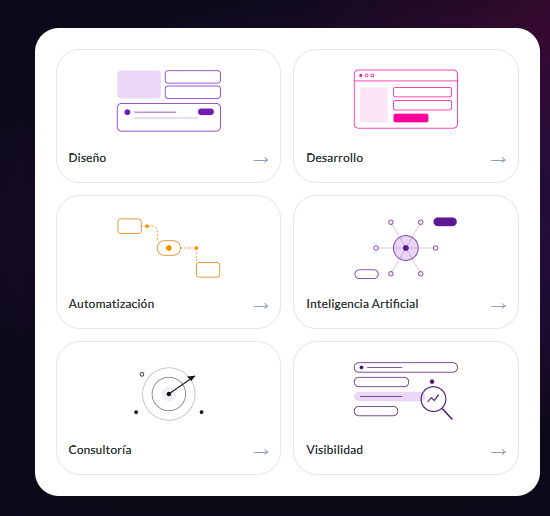 | 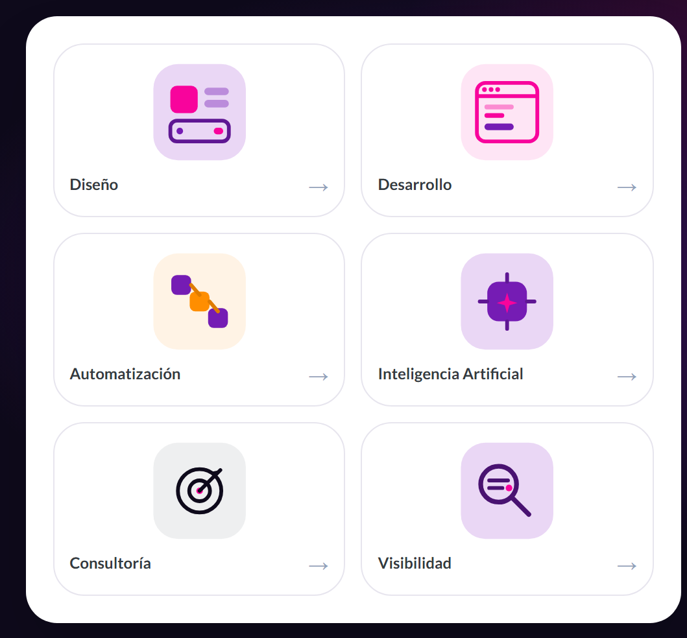 |

Decisión: una sola tile suave por servicio, un objeto protagonista y un acento. Menos piezas, más contraste. Implementado en `src/components/services/ServiceArt.tsx` (commit `6d3629a`).

### 3.2 Cómo se trabaja: de 10 círculos a 4 etapas

**Antes:** una rejilla de 10 círculos iguales con icono, número y nombre. En móvil se veían dos columnas de bolitas, sin contexto ni entregables; no daban ganas de mirarla.

**Después:** cuatro etapas con una historia (Entender → Diseñar → Construir → Evolucionar), cada una con qué pasa, qué te queda y las fases que agrupa. Las 10 fases siguen visibles, pero con jerarquía.

| Antes | Después (desktop) | Después (móvil) |
| --- | --- | --- |
| 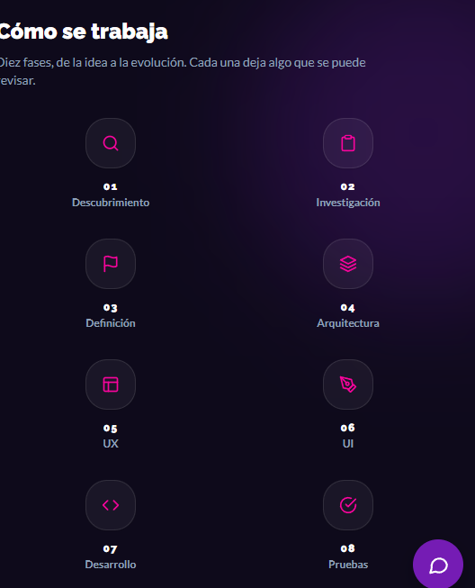 | 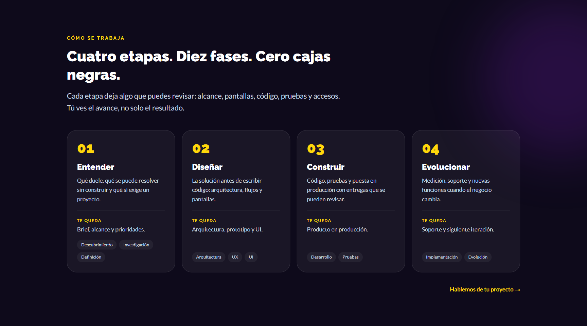 | 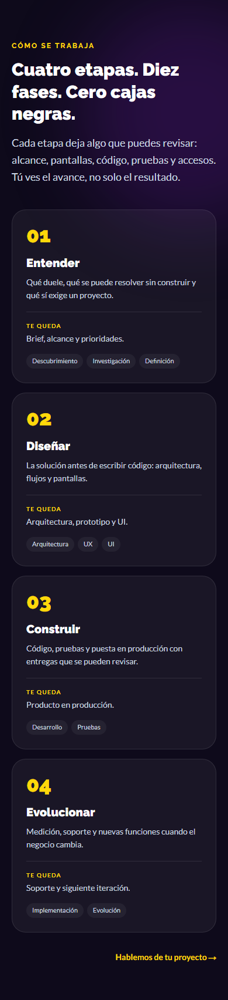 |

Decisión: no mostrar 10 pasos al mismo nivel. El visitante necesita entender el arco, no memorizar una lista. Implementado en `src/components/ProcessStrip.tsx` y en la sección de `/services/` (commit `6794ecb`).

### 3.3 En producción: de lista de texto a caso con captura

**Antes:** una lista dividida con número, sector, nombre y hecho; correcta, pero plana y sin prueba visual.

**Después:** tres fichas horizontales con la captura real del sitio a la izquierda y el caso a la derecha. La imagen es la prueba; el texto dice qué se construyó.

| Antes | Después (desktop) | Después (móvil) |
| --- | --- | --- |
| 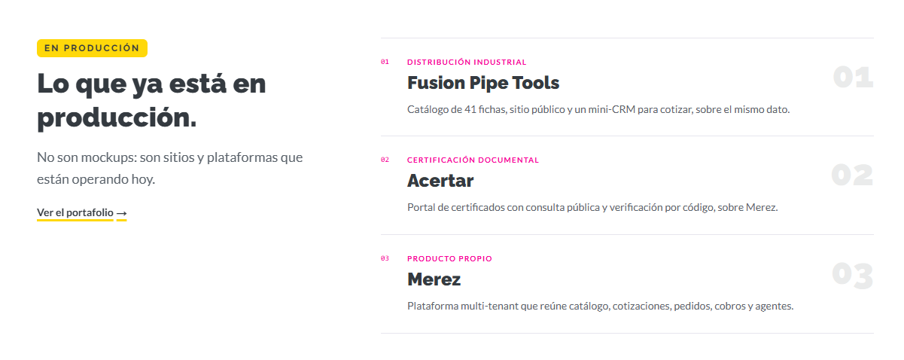 | 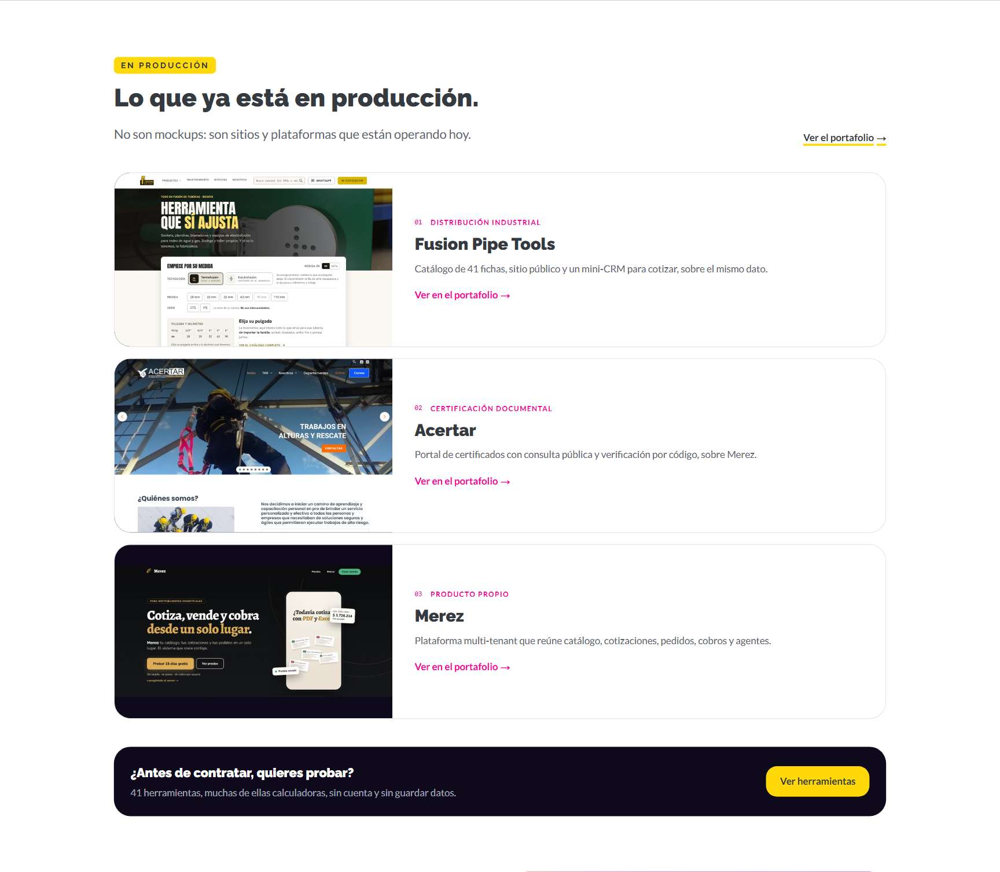 | 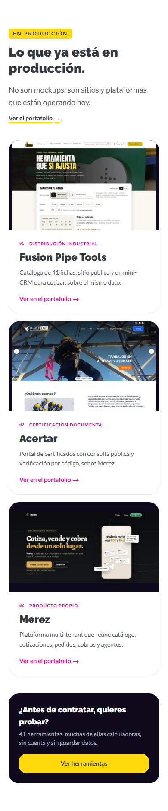 |

Decisiones:
- Capturas reales, no mockups.
- `object-contain` para no cortar el sitio; fondo nocturno para unificar.
- Imágenes eager: al estar lejos del viewport, `loading="lazy"` dejaba paneles negros en las capturas y en la primera visita.

### 3.4 Las seis líneas: el patrón de Tres frentes

**Antes:** cada línea con número/tag a la izquierda, resumen y señal, y una miniatura de arte a la derecha. Se leía como una tabla con imágenes y no emparentaba con la home.

**Después:** el mismo patrón de “Tres frentes”: icono en tile, título, resumen, número fantasma y flecha. El arte pequeño va como icono, no como miniatura.

| Antes | Después (desktop) | Después (móvil) |
| --- | --- | --- |
| 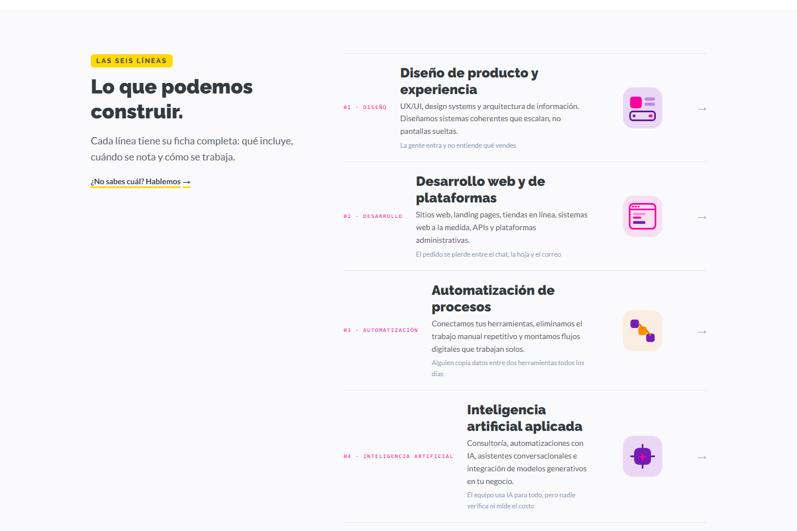 | 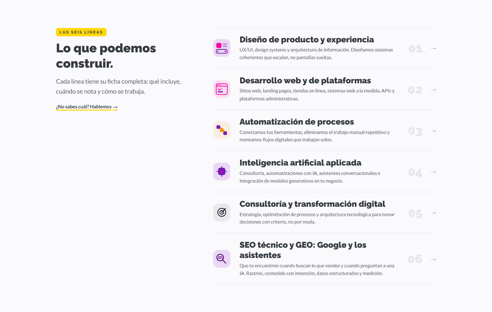 | 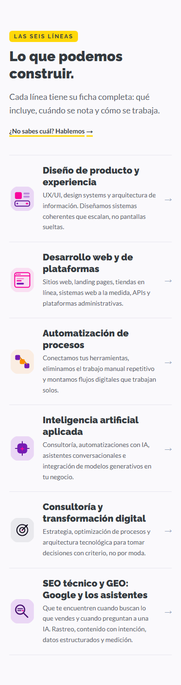 |

Decisión: una lista de seis líneas no necesita seis tarjetas ni seis miniaturas. El icono identifica, el número grande ordena y la flecha invita a entrar. Implementado en `src/app/services/page.tsx` y en `ServiceArt` (variante `compact`).

## 4. Reglas para la próxima iteración

- No volver a una rejilla de 10 pasos iguales. Máximo 4 etapas visibles; las fases van dentro.
- No usar `loading="lazy"` en imágenes de secciones que se capturan o se revisan fuera del viewport.
- No inventar números: 41 herramientas, 6 clientes, 3 casos, 6 líneas y 10 fases salen de datos.
- Reusar `ServiceArt` (tile-icono) y no volver al SVG de líneas finas.
- Las listas de líneas/frentes usan icono + título + resumen + número fantasma + flecha; no volver a miniaturas de arte a la derecha.
- En casos, la captura manda: `object-contain`, fondo oscuro y texto al lado.
- Medir 1440 y 390 (`scrollWidth`) antes de dar una sección por buena.
- Si una sección se siente “horrible”, cambiar la **composición**, no solo el color de fondo.
